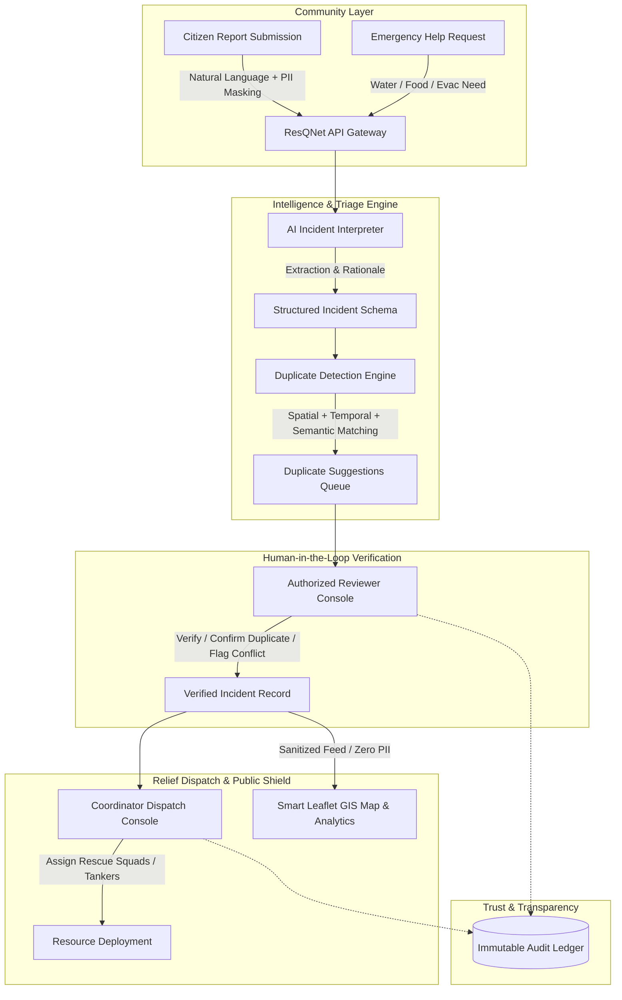

# ResQNet AI — Community Emergency Intelligence Network

> **A resilient, centralized platform transforming unstructured community-submitted emergency reports into structured, verified incident intelligence, duplicate-free coordination, and transparent relief dispatch.**

---

## 🌟 Executive Summary & Problem Statement

During community emergencies (hurricanes, flash flooding, structural collapses, wildfires), emergency call centers and public channels are inundated with hundreds of incoming messages. These community reports are typically:
- **Incomplete & Unstructured**: Missing exact street coordinates, severity ratings, or specific logistical needs.
- **Noisy & Duplicate**: Multiple individuals calling about the exact same blocked underpass or downed powerline.
- **Unverified & Misleading**: Prone to rumors, speculation, or conflicting severity descriptions.
- **Siloed from Dispatch**: Community requests for food, clean water, or rescue struggle to connect with available relief units.

**ResQNet AI** solves this critical bottleneck. It ingests natural-language citizen reports, applies a **Zero-Hallucination AI Incident Interpreter** with structured JSON schema output, proactively identifies candidate duplicates with an explainable multi-factor scoring engine, provides human coordinators with a smart GIS incident map and triage workflow, and logs every verification decision into an immutable audit ledger.

---

## 🏗️ Architecture & Data Pipeline



---

## 🚀 Five Core Innovations

### 1. AI Incident Interpreter
- **Zero-Hallucination Extraction**: Parses raw natural language into structured categories (`FLOOD`, `ROAD_HAZARD`, `FIRE`, `UTILITY_OUTAGE`, `SHELTER_REQUEST`, `MEDICAL_EMERGENCY`, `STRUCTURAL_DAMAGE`), concrete needs (`swift_water_rescue`, `potable_water`), and approximate coordinates.
- **Explainable Urgency Scoring**: Explains *why* an incident requires immediate attention (e.g., life-safety risk in rising floodwaters) rather than giving an opaque black-box number.
- **Strict Human-in-the-Loop Default**: Extracted details are explicitly labeled `UNVERIFIED` until reviewed by an authorized human dispatcher.
- **Dual Engine Architecture**: Supports modern Gemini API inference when configured with an API key, and automatically falls back to an explainable deterministic NLP semantic parser in offline or demo modes.

### 2. Smart Geospatial Incident Map
- **OpenStreetMap Canvas via Leaflet**: Color-coded, pulse-animated markers representing categories and triage states.
- **Review Status Indicators**: Unverified reports display a dashed warning halo; verified and resolved reports display solid status badges.
- **Interactive Pin Picker**: Submitting citizens can click anywhere on the map to pin precise coordinates.
- **PII Privacy Shield**: Reporter phone numbers and email addresses are **never** rendered on public markers or map popups.

### 3. Explainable Duplicate Report Detection
- **Multi-Factor Similarity Metric**:
  $$\text{Score} = (0.35 \times \text{Spatial}) + (0.35 \times \text{Semantic Text}) + (0.15 \times \text{Category}) + (0.15 \times \text{Temporal})$$
- **Non-Destructive Coexistence**: Does not silently delete or overwrite corroborating reports. Suggests matches and generates human-readable rationales (e.g., *"Co-located within 68m and 20 min of existing report; matching terms [underpass, flood, trapped cars]"*).
- **Reviewer Ruling**: Authorizes reviewers to Confirm as Duplicate, Link as Corroborating Report, or Reject as a distinct incident.

### 4. Community Help Coordination
- Direct community intake for basic survival needs: Potable Water, Rations, Temporary Shelter, Evacuation Extraction, and Emergency Power.
- Real-time fleet inventory tracking available vs. deployed squads (Swift Water Rescue Alpha, Potable Water Tankers, Mobile Medical Clinics).
- End-to-end lifecycle progression: `SUBMITTED` $\rightarrow$ `UNDER_REVIEW` $\rightarrow$ `VERIFIED` $\rightarrow$ `ASSIGNED` $\rightarrow$ `RESOLVED`.

### 5. Trust, Privacy & Audit Ledger
- Full role-based authorization for Citizens, Reviewers (Triage EMTs), Coordinators (Dispatch), and Admins.
- Conflict flagging workflow for discrepancies in eyewitness testimony.
- Tamper-evident Audit Ledger tracking actor names, roles, timestamps, previous states, and decision notes for every action.

---

## ⚡ 2-Minute Hackathon Demonstration Walkthrough

ResQNet AI includes a built-in presentation mode with a prominent **"Load Scenario"** button in the top navigation bar.

1. **Step 1 — Community Report Ingestion (`/submit`)**:
   - Citizen David Miller submits a natural-language report of cars trapped in rapidly rising water under the Maple Ave & 5th St railroad underpass.
2. **Step 2 — AI Incident Interpreter (`/analysis`)**:
   - The AI parses the submission into structured fields: Category (`FLOOD`), Needs (`swift_water_rescue`, `vehicle_towing`), Urgency (`HIGH`). Details are tagged `UNVERIFIED`.
3. **Step 3 — Corroborating Eyewitness (`/explorer`)**:
   - A second citizen submits a report 68 meters away regarding deep water under the train bridge.
4. **Step 4 — Duplicate Detection (`/admin`)**:
   - The engine identifies an 89% similarity match, calculates 68m spatial proximity, and explains the matching terms.
5. **Step 5 — Human Triage Decision (`/admin`)**:
   - Reviewer Marcus Vance reviews both reports side-by-side, verifies the flood incident, and links the second report.
6. **Step 6 — Relief Dispatch (`/coordination`)**:
   - Coordinator Elena Rostova assigns **Swift Water Rescue Squad Alpha** to evacuate the stranded motorists.
7. **Step 7 — Live Dashboard & Audit (`/dashboard` & `/analytics`)**:
   - Dashboard KPIs and Recharts reflect active unit deployment, and the audit trail logs the complete timestamped history.
   - Use the **"Reset Demo"** button anytime to restore the pristine state.

---

## 💻 Tech Stack

- **Frontend**: React 19, TypeScript, Vite, Tailwind CSS, Lucide Icons
- **Interactive Maps**: Leaflet, OpenStreetMap CartoDB Tiles
- **Data Visualizations**: Recharts
- **Backend**: Node.js, Express, TypeScript
- **Database & ORM**: SQLite / PostgreSQL via Prisma ORM
- **Validation**: Zod (strict schema enforcement for API requests and AI outputs)
- **AI Engine**: Google Gemini API (`@google/genai` / REST) with deterministic explainable fallback
- **Testing**: Vitest (15 unit & integration tests covering duplicate detection, validation, transitions)

---

## 🛠️ Quickstart & Local Setup

### Prerequisites
- Node.js (v18+ or v20+)
- npm or pnpm

### 1. Clone & Install Dependencies
```bash
# Install root, server, and client dependencies
npm run install:all
```
*(Or install individually: `cd server && npm install && cd ../client && npm install`)*

### 2. Configure Environment Variables
Copy `.env.example` in both server and root:
```bash
# Server configuration (server/.env)
PORT=3001
NODE_ENV=development
DATABASE_URL="file:./dev.db"

# Optional Gemini API key (leave empty to use built-in explainable NLP simulation)
GEMINI_API_KEY=""
GEMINI_MODEL="gemini-1.5-flash"
```

### 3. Initialize & Seed Database
```bash
cd server
npm run db:push
npm run db:seed
```

### 4. Run Automated Tests
```bash
cd server
npm test
```

### 5. Launch Application
In the root directory, start both the backend server and frontend client concurrently:
```bash
npm run dev
```
- **Frontend Web UI**: [http://localhost:5173](http://localhost:5173)
- **Backend API**: [http://localhost:3001/api](http://localhost:3001/api)
- **Health Endpoint**: [http://localhost:3001/api/health](http://localhost:3001/api/health)

---

## 🔒 Security & Privacy Practices

1. **Confidential PII**: Reporter contact numbers and emails are masked in public endpoints and only visible to authorized Coordinators and Admins.
2. **Schema Sanitization**: All inbound payloads pass Zod schema validation before database writes.
3. **Role-Based Headers**: The client simulated persona switcher uses `x-user-role`, `x-user-id`, and `x-user-name` headers to simulate distinct responder tiers (`CITIZEN`, `REVIEWER`, `COORDINATOR`, `ADMIN`).
4. **No Direct Real-World Dispatch**: All operations occur within a simulated municipal environment. Real emergency numbers (911) are never dialed automatically.

---

## 📄 License
MIT License. Built for civic hackathons, public safety innovation, and disaster resilience.
